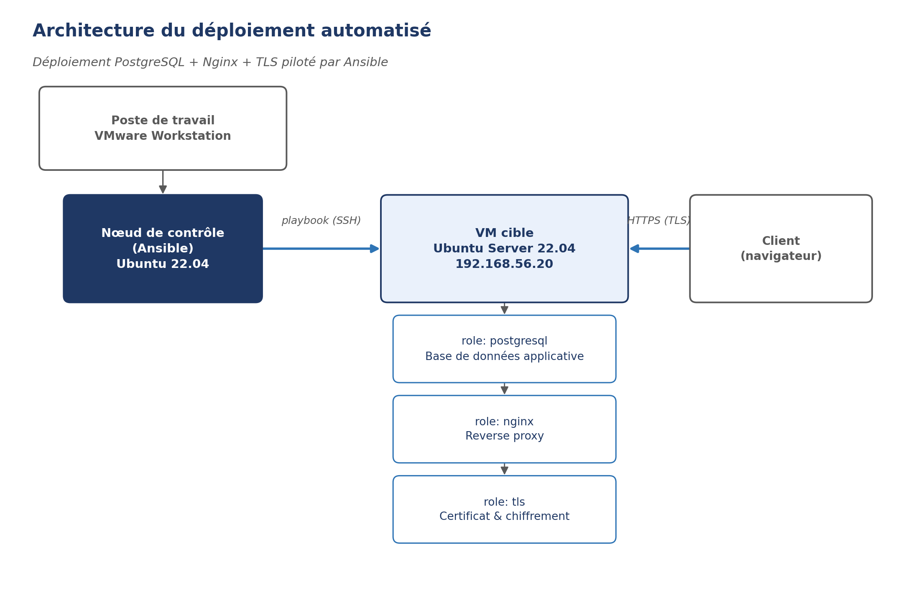

# Déploiement automatisé d'un serveur Linux avec Ansible

J'ai monté ce lab pour m'entraîner à automatiser un déploiement de bout en bout, comme on le ferait avant de le confier à une équipe d'exploitation : une base PostgreSQL, un reverse proxy Nginx et un certificat TLS, le tout installé et configuré par Ansible plutôt qu'à la main.

## Pourquoi ce projet

Je voulais sortir du réflexe "je me connecte en SSH et j'installe au fur et à mesure". Sur un vrai poste d'administrateur, il faut pouvoir reconstruire un serveur à l'identique en quelques minutes, documenter ce qui a été fait, et être sûr qu'un changement ne casse rien. Ansible m'a semblé le bon outil pour prendre cette habitude tôt.

## Architecture



Le nœud de contrôle (mon poste, sous VMware Workstation) exécute le playbook en SSH vers une VM cible Ubuntu Server 22.04. Trois rôles s'enchaînent sur la VM cible : `postgresql` installe et configure la base, `nginx` met en place le reverse proxy, `tls` génère le certificat qui sécurise l'accès HTTPS.

## Environnement

| Élément | Détail |
|---|---|
| Virtualisation | VMware Workstation |
| Nœud de contrôle | Ubuntu 22.04, Ansible 2.16 |
| VM cible | Ubuntu Server 22.04, IP statique 192.168.56.20 |
| Base de données | PostgreSQL 14 |
| Reverse proxy | Nginx |
| Certificat | Auto-signé en lab (le rôle `tls` est prévu pour être remplacé par Let's Encrypt en production) |

## Structure du dépôt

```
ansible-lab-deployment/
├── ansible.cfg
├── inventory/
│   └── hosts.ini
├── playbooks/
│   └── site.yml
├── vars/
│   ├── main.yml
│   └── secrets.yml.example
├── roles/
│   ├── postgresql/
│   │   ├── tasks/main.yml
│   │   ├── handlers/main.yml
│   │   ├── defaults/main.yml
│   │   └── templates/
│   │       ├── postgresql.conf.j2
│   │       └── pg_hba.conf.j2
│   ├── nginx/
│   │   ├── tasks/main.yml
│   │   ├── handlers/main.yml
│   │   └── templates/nginx.conf.j2
│   └── tls/
│       ├── tasks/main.yml
│       └── handlers/main.yml
├── scripts/
│   └── post_install_tests.sh
└── docs/
    └── architecture.png
```

## Comment je l'ai construit

1. **Le rôle `postgresql`** installe le paquet, démarre le service, puis pousse une configuration `postgresql.conf` et `pg_hba.conf` volontairement restrictive : la base n'écoute qu'en local, et seul le rôle applicatif peut s'y connecter. Le mot de passe passe par `ansible-vault` (voir `vars/secrets.yml.example`), il n'est jamais écrit en clair dans le dépôt.

2. **Le rôle `nginx`** désactive le site par défaut, déploie une configuration dédiée au domaine du lab, et redirige systématiquement le HTTP vers le HTTPS.

3. **Le rôle `tls`** génère une clé privée et un certificat auto-signé si aucun n'existe déjà (le `stat` en début de tâche évite de régénérer un certificat à chaque exécution). En conditions réelles, ce rôle serait remplacé par un appel à Certbot ou à la PKI de l'entreprise.

4. **Le script `post_install_tests.sh`** vérifie, une fois le playbook terminé, que PostgreSQL répond, que Nginx est actif, que la redirection HTTPS fonctionne et que le certificat n'expire pas dans les 30 jours. C'est volontairement simple : l'objectif est d'attraper vite une erreur évidente, pas de remplacer une vraie suite de tests.

## Utilisation

```bash
# Déployer l'ensemble
ansible-playbook playbooks/site.yml

# Ne rejouer qu'un rôle (utile pendant le développement)
ansible-playbook playbooks/site.yml --tags nginx

# Vérifier après déploiement
./scripts/post_install_tests.sh
```

## Ce que j'ai retenu

Le plus long n'a pas été d'écrire les tâches Ansible, mais de bien découper les rôles et les handlers pour qu'un changement dans un rôle (par exemple régénérer le certificat) déclenche correctement le rechargement de Nginx sans redémarrer tout le service. J'ai aussi appris à ne jamais versionner un secret en clair, même dans un lab.

## Prochaines étapes possibles

- Remplacer le certificat auto-signé par un vrai certificat Let's Encrypt via Certbot.
- Ajouter un rôle de sauvegarde automatique de la base (`pg_dump` planifié).
- Intégrer le playbook dans une pipeline CI simple (lint + `--check` avant tout déploiement réel).

## Auteur

GNAGAN Komlan Josue — [github.com/Josue21-mar](https://github.com/Josue21-mar)
